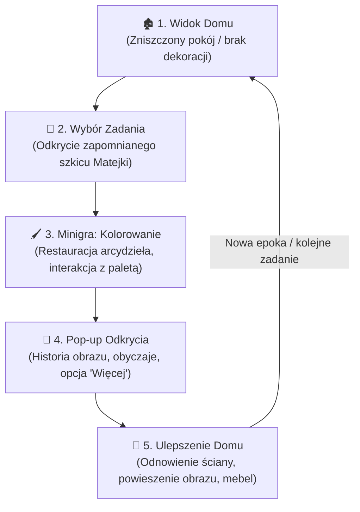

# 🎮 02. Game Design Document (GDD)

> **Mechaniki pierwotnej koncepcji.** Zespół zastąpił kolorowanie konturów planszą 15×15 i dodał hol z czterema pokojami epok. Ulepszenia są automatyczne. Aktualne zasady i otwarte decyzje zawiera [plan 07](./07_CURRENT_PROJECT_PLAN.md), który ma pierwszeństwo.

> **Tytuł:** *Game Loop, Mechaniki i Doświadczenie Gracza*  
> **Inspiracje:** *Garden Keeper*, *Gardenscapes*, *Unpacking*, *I Love Hue / Color by Number*, *Passpartout*

---

## 🔄 1. Główna Pętla Gry (Core Game Loop)

Główna pętla gry składa się z 5 powtarzalnych, satysfakcjonujących etapów:

---

## 🖌️ 2. Minigra: Kolorowanka Historyczna (Art Restoration)

### Założenie mechaniki:
Zamiast tradycyjnego, nudnego testu z wiedzy, gracz wciela się w **konserwatora zabytków**. Dzieło sztuki (np. *Stańczyk*, *Bitwa pod Grunwaldem*, *Chrzest Polski*) pojawia się jako monochromatyczny szkic podzielony na numerowane lub konturowe segmenty.

### Jak to działa dla gracza:
1. **Wybór koloru z palety historycznej:** Na dole ekranu znajduje się paleta (np. 5–8 kluczowych barw z oryginalnego dzieła).
2. **Wypełnianie segmentów:** 
   - Kliknięcie / dotknięcie segmentu pasującego do wybranego koloru powoduje jego wypełnienie płynną animacją akwareli/oleju.
   - Opcja podświetlenia pasujących fragmentów (dla relaksu i braku frustracji).
3. **Poczucie postępu:** Pasek procentowy (np. 0% $\rightarrow$ 100%).
4. **Efekt ukończenia ("Masterpiece Restored!"):**
   - Obraz rozbłyska, pojawia się złota rama.
   - Odtwarzany jest satysfakcjonujący dżwięk triumfu (np. łagodne uderzenie w dzwon lub akord lutni).

---

## 📜 3. Warstwa Wiedzy: Pop-up Odkrycia (Cultural Story Popup)

Po ukończeniu kolorowanki pojawia się okno dialogowe zorganizowane na zasadzie **dwupoziomowego odkrywania wiedzy (Bite-sized + Deep Dive)**:

### Poziom 1: Pigułka (Bite-sized - widoczna od razu)
- **Tytuł obrazu:** np. *„Stańczyk (The Jester)”* – Jan Matejko (1862).
- **Haczyk emocjonalny (1-2 zdania):**  
  *„While everyone in the royal ballroom is dancing, the court jester sits alone in despair. Why? He just read the news that a crucial border fortress was lost.”*
- **Obyczaj / Ciekawostka kulturowa:**  
  *„In Renaissance Poland, the court jester was not just a clown — he was often the only person allowed to speak uncomfortable truths to the King.”*

### Poziom 2: „Dowiedz się więcej” (Deep Dive - rozwijany przycisk)
- Rozwija ciekawostki o stroju (charakterystyczna czapka z dzwonkami, czerwień symbolizująca szlachecką powagę), wydarzeniu historycznym (upadek Smoleńska) i wpływie obrazu na tożsamość Polaków.
- Przycisk akcji: **„Hang in the Manor (+50 Inspiration)”** $\rightarrow$ Przejście do widoku domu.

---

## 🏡 4. Ewolucja Domu (House Renovation System)

Dom jest centralnym hubem gracza i reprezentuje ducha Polski w danej epoce.

### Mechanika renowacji:
1. **Początkowy stan:**
   - Popękana podłoga, zbutwiałe ściany, przeciekający dach, brak mebli.
2. **Kolejne ulepszenia po zadaniach:**
   - **Krok 1 (Ściana i Podłoga):** Zbutwiałe deski zamieniają się w solidne, heblowane drewno dębowe.
   - **Krok 2 (Galeria na Ścianie):** Powieszenie ukończonego obrazu w złoconej ramie na centralnym miejscu.
   - **Krok 3 (Mebel / Artefakt z Epoki):** Pojawia się tradycyjny obiekt (np. rzeźbiony kredens, piec kaflowy z kaflami z motywami orła, czy staropolski stół).
   - **Krok 4 (Interaktywne detale):** Na stole pojawia się gliniany dzban, bochen chleba i sól.
3. **Klikalne punkty w pokoju (Inspect Mode):**
   - Gracz może kliknąć na powieszony obraz lub wstawiony mebel w dowolnym momencie, aby ponownie przeczytać o nim ciekawostkę.

---

## ⏳ 5. Progresja Epok (Chronological Evolution)

Gra prowadzi gracza przez kolejne wieki:

| Epoka | Styl Domu | Przykładowy Obraz (Zadanie) | Kluczowy Mebel / Artefakt |
| :--- | :--- | :--- | :--- |
| **I. Średniowiecze (X-XIV w.)** | Słowiańska dębowa chata, palenisko kamienne | *Chrzest Polski* (Matejko) | Kamienne palenisko, gliniane naczynia, tarcza piastowska |
| **II. Złoty Wiek / Renesans (XV-XVI w.)** | Renesansowy dwór, krużganki, bogate sukna | *Hołd Pruski* lub *Dzwon Zygmunta* (Matejko) | Gobelin/arrasy, dębowe biurko z księgami, lutnia |
| **III. Sarmatyzm i Barok (XVII-XVIII w.)** | Szlachecki dworek modrzewiowy, kominek | *Sobieski pod Wiedniem* (Matejko) | Szabla husarska, pas kontuszowy, portret trumienny |
| **IV. Walka o Wolność i Romantyzm (XIX w.)** | Salon inteligencki, fortepian, ciepłe światło świec | *Stańczyk* (Matejko) / *Bociany* (Chełmoński) | Fortepian chopinowski, kandelabr, zielony szezlong |

*(Na potrzeby hackathonu MVP skupia się na 1–2 dopracowanych epokach z możliwością rozbudowy).*

---

## 🪙 6. Ekonomia i Waluta

- **Iskry Pamięci / Wena (Inspiration Points):** Zdobywane za odrestaurowanie dzieła sztuki.
- Służą do odblokowywania wariantów wizualnych domu (np. wybór koloru zasłon lub rodzaju drewnianej podłogi, co daje graczowi poczucie personalizacji i sprawczości).
