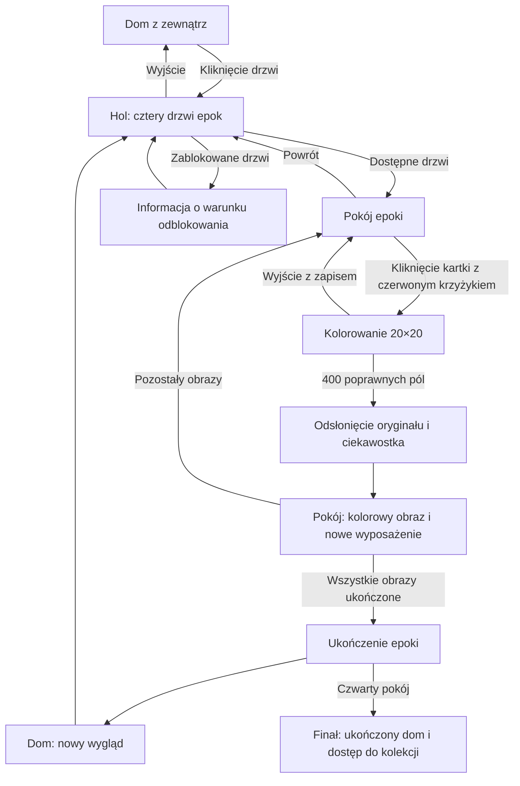

# 07. Aktualny plan: dom, cztery epoki i kolorowanie 20×20

> Aktualizacja: 10 października 2026. Etap: pierwsza implementacja frontendu.
> Ten dokument zastępuje wcześniejsze założenia dotyczące nawigacji, kolorowania i progresji w dokumentach 01–06.
> **Ustalone** oznacza instrukcję zespołu. **Propozycja** oznacza rozwiązanie do omówienia. **Otwarte** oznacza brak decyzji.

## Najnowsze zatwierdzone decyzje

- Pierwsza wersja jest **pełnoekranową grą**: dom, hol i cztery pokoje wypełniają ekran, a header i przyciski glass są nakładane na ilustrację. Kamera ma przesuwanie i opcję pokazania całej sceny; strona nie przewija się poza grą.
- Hol ma cztery wersje materiałów zgodne z epokami, przy tej samej kamerze i czterech drzwiach. Pliki `hall1.jpg`–`hall4.jpg`; prompty w [dokumencie 11](./11_HALL_PROMPTS_FOUR_ERAS.md).
- Kolorowanie **20×20** i jego logikę implementuje inny członek zespołu. Wcześniejszy kontrakt poniżej jest propozycją, nie zobowiązaniem dla właściciela minigry.
- Stack: Next.js + TypeScript + Tailwind + Zustand. Polski domyślnie, przełącznik na angielski.
- Nazwa Dziedzictwo zostaje. Cztery robocze epoki zaakceptowane, ale zespół planuje zmianę ich nazw i grafik; dane są konfigurowalne.
- Mała kartka pod każdym obrazem otwiera historię i ciekawostkę. Lista dzieł i lista nagród nie są jeszcze gotowe.
- Lokalny zapis wystarczy. Nie potrzeba tutoriala ani audio. Kod w obecnym repozytorium, hosting zespołu.
- Wszystkie pokoje w v1 są dostępne do oceny UI. Docelowe odblokowania i wyposażenie po integracji minigry.
- **Implementacja i adapter dla kolegi:** [10_FRONTEND_V1.md](./10_FRONTEND_V1.md).

Dalsze sekcje zachowują plan pełnej gry oraz starsze propozycje. Powyższe decyzje i najnowsze instrukcje użytkownika mają pierwszeństwo.

## 1. Wizja w jednym zdaniu

Gracz wchodzi do domu polskiej historii, przywraca kolory obrazom w czterech pokojach epok, a jego praca automatycznie urządza wnętrza i zmienia wygląd całego domu.

Gra ma dwie pętle nagród:

- Obraz → kolorowanie 20×20 → odsłonięcie oryginału → wyposażenie pokoju.
- Wszystkie obrazy pokoju → ukończenie epoki → ulepszenie domu z zewnątrz → odblokowanie następnych drzwi.

## 2. Ustalenia zespołu i decyzje otwarte

### Ustalone przez zespół

1. Strona główna przedstawia dom z zewnątrz.
2. Kliknięcie drzwi prowadzi do wnętrza z czterema drzwiami do pokojów.
3. Każdy pokój przedstawia inną epokę Polski.
4. Epoki mają obejmować drogę od powstania Polski do współczesności; konkretne cztery rozdziały są jeszcze propozycją.
5. W miejscach nieukończonych obrazów na ścianach wiszą przetarte biało-szare kartki papieru z czerwonym krzyżykiem. Kartka nie przedstawia reprodukcji dzieła.
6. Główna mechanika to kolorowanie po numerach na planszy **20×20 = 400 pól**.
7. Algorytm przygotowujący plansze tworzy członek zespołu.
8. Ukończenie obrazu przywraca naturalny kolorowy obraz na ścianę i automatycznie dodaje wyposażenie z epoki.
9. Ukończenie wszystkich obrazów pokoju automatycznie ulepsza dom oraz odblokowuje następny pokój.
10. Oprawa to ilustracje 2D z kreskowymi konturami, malarskim cieniowaniem i elementami realizmu, zgodnie z dwiema referencjami wnętrza dostarczonymi przez użytkownika. Użytkownik zajmuje się frontendem i będzie generował grafiki w Google Flow. Lista assetów i prompty są w [dokumencie 08](./08_ASSET_PROMPTS_GOOGLE_FLOW.md).
11. Pozostało **15 godzin**, pracują **cztery osoby, każda z własnym Codexem**.
12. Aplikacja jest **mobile-first**: podstawowe urządzenie to telefon, pionowa orientacja i obsługa dotykiem. Dom, hol i pokoje komponujemy pod ekran telefonu; komputer jest adaptacją układu mobilnego.
13. Tło każdego pokoju pokazuje **wewnętrzny narożnik i dwie szerokie ściany**, z drzwiami do **poprzedniej i następnej epoki** na lewej i prawej stronie. Ściany są puste, bez wyznaczonych miejsc ani układu obrazów. Frontend rozmieszcza na nich początkowo pięć obrazów, z możliwością późniejszego rozszerzenia. Aktualne prompty: [dokument 09](./09_ROOM_PROMPTS_CORNER_VIEW.md). Liczba obowiązkowych zadań na demo pozostaje do ustalenia.

### Propozycje robocze

- Pierwszy pokój dostępny od początku, trzy następne zablokowane i widoczne.
- Można wracać do wcześniej odblokowanych pokojów.
- Obrazy w dostępnym pokoju można kończyć w dowolnej kolejności.
- Podstawowy zakres: cztery pokoje, przynajmniej jeden obraz w każdym. Drugi obraz pierwszego pokoju pozwoli wyraźnie pokazać stopniowe wyposażanie wnętrza.
- Brak wymaganej waluty lub zakupów: nagrody przyznawane automatycznie. Dawne „Inspiration Points” pozostają pomysłem dodatkowym do decyzji.
- Plansze są przygotowane przed grą, a aplikacja wczytuje gotowe dane.
- Po ukończeniu planszy aplikacja odsłania zachowany oryginał obrazu.
- Potwierdzono PL jako język domyślny, przełącznik EN i lokalny zapis postępu.

### Otwarte decyzje o największym wpływie

- Dokładne epoki i lista obrazów, liczba obrazów na prezentację.
- Format wyniku algorytmu, liczba kolorów, obsługa proporcji oryginału.
- Czy „powrót do naturalnego obrazu” to odsłonięcie oryginału, czy inne przetwarzanie?
- Dotknięcia/przeciąganie oraz obsługa błędów; priorytet telefonu jest potwierdzony.
- Charakter zmian domu: kolejne architektury czy renowacja jednej bryły?
- Format, terminy i osoba odpowiedzialna za dostarczenie grafik.

## 3. Cztery rozdziały historii — propozycja

To cztery szerokie rozdziały gry, obejmujące różne epoki, a nie ścisła periodyzacja historii sztuki. Taki podział pozwala dojść do współczesności przy czterech drzwiach.

| Kolejność | Robocza nazwa pokoju | Zakres narracji | Charakter wnętrza | Przykładowe nagrody do doboru |
| --- | --- | --- | --- | --- |
| 1 | Początki Polski | Powstanie państwa i średniowiecze, do końca XV wieku | Drewno, kamień, ciepłe światło paleniska | Ława, skrzynia, naczynia, tkanina |
| 2 | Dawna Rzeczpospolita | XVI wiek–1795: renesans, życie dworskie, kultura szlachecka, reformy | Stylizowany dwór; spójny wybrany moment epoki | Biurko, księga, arras, świecznik |
| 3 | Droga do niepodległości | 1795–1918: kultura w okresie rozbiorów, wieś, miasta, tożsamość | Salon z przełomu XIX i XX wieku | Fortepian, biblioteczka, lampa, dekoracje ludowe |
| 4 | Polska nowoczesna | 1918–współczesność: sztuka i życie codzienne XX–XXI wieku | Wnętrze z warstwami modernizmu i współczesności | Radio, plakat, współczesne oświetlenie, roślina |

Wyposażenie trzeba wybrać dla konkretnego charakteru pokoju; lista powyżej nie oznacza, że wszystkie wymienione przedmioty powstały w danym okresie. W pokoju drugim nie mieszamy przypadkowo kilku stuleci bez wyjaśnienia.

### Kandydaci na pierwsze obrazy

- Pokój 1: Jan Matejko, **„Zaprowadzenie chrześcijaństwa. R.P. 965”**. To dokładny tytuł dzieła opisywanego wcześniej skrótowo jako „Chrzest Polski”. Muzeum datuje obraz na 1889; rozdział dotyczy przedstawionej przeszłości, nie roku namalowania. [Katalog MNW](https://cyfrowe.mnw.art.pl/pl/zbiory/446409).
- Pokój 2: Jan Matejko, **„Hołd pruski”**. Obraz z 1882 przedstawia wydarzenie z 1525; oba lata mają osobne miejsce w opisie. [Opis MNK](https://zbiory.mnk.pl/pl/eseje/18). „Stańczyk” z wcześniejszej dokumentacji pozostaje alternatywnym kandydatem.
- Pokój 3: Józef Chełmoński, **„Bociany”**, 1900. [Materiały MNK](https://media.mnk.pl/aktualnosci/chelmonski).
- Pokój 4: Tadeusz Makowski, **„Kapela dziecięca”**, 1922, jako wejście do sztuki XX wieku. [Materiały edukacyjne MNW](https://www.mnw.art.pl/gfx/muzeumnarodowe/userfiles/adlugolecka/tadeusz_makowski.pdf). Dzieło nie reprezentuje samo w sobie współczesnej Polski: aby rzeczywiście dojść do XXI wieku, trzeba dodać współczesne dzieło dopuszczone do użycia lub przygotowaną przez zespół ilustrację oznaczoną jako współczesna interpretacja.

Lista jest propozycją. Każdy kandydat musi przejść próbę czytelności w 20×20, mieć reprodukcję odpowiedniej jakości i zapisane źródło oraz warunki wykorzystania. Same monumentalne sceny z wieloma postaciami mogą słabo czytać się w 400 polach. Ostateczny wybór następuje po obejrzeniu wyników algorytmu.

## 4. Mapa aplikacji i nawigacja



Proponowane adresy:

| Widok | Adres | Cel |
| --- | --- | --- |
| Dom z zewnątrz | `/` | Wejście i globalny postęp |
| Hol | `/hall` | Cztery drzwi i stany odblokowania |
| Pokój | `/rooms/[roomId]` | Obrazy, wyposażenie, postęp epoki |
| Malowanie | `/paint/[artworkId]` | Plansza, paleta, zapis |

Podgląd ukończonego obrazu i ciekawostka mogą być oknami w pokoju. Finał może być nakładką na dom. Przy wejściu bezpośrednio przez URL sprawdzamy dostępność pokoju i przynależność obrazu.

## 5. Plan ekranów

### A. Dom z zewnątrz

Dom jest centralnym elementem pionowej ilustracji, proponowana proporcja 9:16. Zajmuje większość szerokości telefonu, z widocznym dachem i wejściem. Drzwi są wyraźnie oznaczone i reagują na dotknięcie. Przycisk „Wejdź do domu” w dolnej strefie ekranu pomaga odkryć interakcję i wejść wygodnie kciukiem. W górnej strefie znajdują się tytuł oraz ustawienia języka i dźwięku, jeśli trafią do zakresu. Hover jest dodatkiem dla komputera.

Postęp globalny pokazujemy jako „Ukończone epoki: 0/4”. Kliknięcie drzwi może uruchamiać krótkie zbliżenie lub przenikanie scen. Osoba wracająca do gry widzi aktualny wygląd domu; nadal może wejść drzwiami.

Potrzeba pięciu stanów elewacji: start i cztery ukończone rozdziały. Można dostarczyć pięć ilustracji lub jedną bazę z warstwami; wybór zależy od grafik zespołu.

### B. Hol z czterema drzwiami

Wszystkie drzwi są widoczne od początku. Każde mają nazwę rozdziału i oznaczenie stanu:

- Zablokowane: kłódka i komunikat „Ukończ poprzedni pokój”.
- Dostępne: zaproszenie do wejścia, postęp np. „1/2 obrazy”.
- Ukończone: wyraźne oznaczenie i możliwość ponownego wejścia.

Hol projektujemy jako pionową scenę. Proponowany układ ilustracji: krótki hol z płytką perspektywą, dwoje drzwi po lewej i dwoje po prawej. Wszystkie cztery muszą być widoczne i dostatecznie duże na telefonie. Podpisy i kłódki dodajemy we frontendzie. Proponujemy obszary dotyku co najmniej 48×48 CSS px; nie wymagamy hover do odkrycia interakcji. Każde drzwi mają tekstowy odpowiednik dostępny również z klawiatury.

### C. Pokój epoki

Scena zawiera ściany, podłogę, miejsca na meble i ramy na obrazy. W każdej ramie nieukończonego dzieła znajduje się przetarta biało-szara kartka papieru z czerwonym krzyżykiem. Faktura papieru ma ślady zużycia i przetarcia. Kliknięcie kartki otwiera kolorowanie przypisanego obrazu. Także po rozpoczęciu malowania kartka pozostaje na ścianie aż do ukończenia; postęp można oznaczyć osobnym licznikiem.

Tło jest puste, z widokiem na wewnętrzny narożnik pokoju w dalszym kadrze. Kamera na wysokości oczu jest odsunięta kilka metrów i pokazuje dwie szerokie ściany, których pionowy styk jest blisko środka kadru. Widać fragment sufitu i większą powierzchnię podłogi. Generator nie wyznacza miejsc, rzędów ani stref dla obrazów. Frontend rozmieszcza obrazy na obu ścianach po obejrzeniu tła, uwzględniając perspektywę każdej płaszczyzny. Na lewej i prawej ścianie są zamknięte drzwi do poprzedniej i następnej epoki; całe skrzydła oraz ościeżnice mieszczą się w kadrze z pasem ściany po zewnętrznej stronie. Prawe drzwi zachowują regułę odblokowania po ukończeniu pokoju. Propozycja przypadków granicznych: pierwsze lewe drzwi wracają do holu, a ostatnie prawe prowadzą do finału/ukończonego domu. Powrót do holu pozostaje także w interfejsie. Meble nie zasłaniają obu przejść.

Po ukończeniu kolorowania kartkę zastępuje naturalna kolorowa reprodukcja w tej samej ramie. Ponowne kliknięcie otwiera duży podgląd i opis, zamiast ponownie naliczać nagrodę. W nagłówku są nazwa epoki, licznik ukończonych obrazów i powrót do holu.

Wyposażenie pojawia się w konkretnym miejscu po ukończeniu przypisanego obrazu. Meble nie zasłaniają klikalnych obrazów. Każdy pokój zachowuje własny wygląd także po odblokowaniu późniejszych epok.

### D. Kolorowanie

- Główna plansza ma 20 kolumn i 20 wierszy.
- Każde nieukończone pole pokazuje numer koloru.
- Paleta pokazuje kolor, numer i liczbę pozostałych pól.
- Wybrany kolor jest oznaczony także obrysem/tekstem.
- Postęp: liczba poprawnych pól i procent.
- Podświetlenie pasujących pól: propozycja pomocy.
- Wyjście zapisuje stan; użytkownik może wrócić do tej samej planszy.
- Przybliżenie i przesuwanie umożliwiają precyzyjne malowanie na telefonie. Paleta i przyciski znajdują się pod kwadratową planszą, w pionowym układzie.

Przy planszy szerokiej na 300 px pojedyncze pole ma tylko 20 px. Samo pomniejszenie widoku nie rozwiąże obsługi telefonu. Telefon jest urządzeniem podstawowym, więc przewidujemy powiększenie planszy i rozdzielenie gestu malowania od przesuwania. Propozycja: jawne tryby „Maluj” oraz „Przesuń” i dostępne przyciski zoomu. Jeśli dopuszczamy przeciąganie pędzla, przewijanie strony nie może przejmować gestu malowania.

### E. Ukończenie obrazu

Ostatnie poprawne pole kończy zadanie. Numery i siatka znikają, następnie plansza płynnie przechodzi w naturalny obraz. Pojawia się tytuł, autor i krótka ciekawostka, jeśli warstwa edukacyjna jest w zakresie.

Po powrocie do pokoju obraz jest już kolorowy, a nowe wyposażenie pojawia się animacją. Jeśli to ostatni obraz pokoju, pokazujemy jeszcze ukończenie epoki i zmianę domu. Kolejność prezentacji: obraz → nagroda pokoju → dom → następne drzwi. Stan gry zostaje zapisany przed animacjami.

### F. Finał

Po czwartym pokoju dom osiąga ostatni wariant. Gracz może obejrzeć ukończone pokoje i wszystkie obrazy. Dodatkowe pobieranie obrazów i certyfikaty pozostają poza podstawowym zakresem.

## 6. Zasady malowania — propozycja do ustalenia

1. Użytkownik wybiera numer koloru w palecie.
2. Kliknięcie zgodnego pola wypełnia je i usuwa numer.
3. Niezgodne pole nie zmienia koloru; delikatnie wskazuje swój numer. Bez kar i limitu czasu.
4. Powtórne dotknięcie poprawnego pola nie zmienia postępu.
5. Przeciąganie, jeśli wdrożone, maluje wyłącznie pasujące, nieukończone pola.
6. Wyjście i odświeżenie zachowują postęp.
7. Ukończenie wymaga wszystkich 400 poprawnych pól.
8. Proponowana paleta startowa: 6–8 kolorów; wartość potwierdzamy z autorem algorytmu i po próbie obrazu.
9. Jeśli kolor nie ma już niepomalowanych pól, oznaczamy go jako ukończony. Automatyczny wybór kolejnego koloru wymaga decyzji.

Kolory białe i czarne także są numerowanymi kolorami do wypełnienia. Propozycja kontraktu nie zawiera pustych, niegrywalnych pól; jeśli algorytm ich potrzebuje, trzeba osobno określić maskę aktywnych pól i mianownik postępu.

400 ręcznych kliknięć przy założeniu 1–2 pól na sekundę daje ok. 3–7 minut samego wypełniania, bez wyszukiwania numerów. To szacunek, który trzeba zweryfikować testem. Cztery obrazy oznaczają 1600 pól, pięć obrazów 2000. Przeciąganie wpływa zarówno na wygodę, jak i długość rozgrywki.

## 7. Algorytm i umowa danych

### Proponowany przepływ

```text
Kolorowa reprodukcja
  → ustalone dopasowanie proporcji
  → pomniejszenie do 20×20
  → ograniczenie do ustalonej palety
  → przypisanie numeru koloru każdemu polu
  → JSON + zachowany oryginał
  → gra w przeglądarce
```

Algorytm wykonuje się podczas przygotowywania zawartości. W MVP nie musi działać jako usługa ani w czasie wizyty gracza. To propozycja integracji, wymagająca potwierdzenia przez autora algorytmu.

### Kontrakt roboczy v1

```typescript
interface PaintingPuzzle {
  schemaVersion: 1;
  artworkId: string;
  puzzleVersion: string;
  width: 20;
  height: 20;
  originalImageUrl: string;
  imageFit: 'contain' | 'crop';
  palette: Array<{
    number: number;
    hex: string;
  }>;
  cells: number[];
}
```

Wymagania kontraktu:

- `cells` ma dokładnie 400 elementów.
- Kolejność wierszowa, od lewej do prawej, od góry do dołu.
- Indeks pola: `row * 20 + column`, wiersz i kolumna od 0 do 19.
- Numery kolorów są dodatnimi, unikalnymi liczbami całkowitymi, zaczynając od 1.
- Każdy numer pola występuje w palecie; aplikacja korzysta z mapy numerów, nie zakłada indeksu tablicy.
- Kolory mają format `#RRGGBB`.
- `artworkId` jest identyczny z identyfikatorem dzieła w danych aplikacji.
- `originalImageUrl` wskazuje zachowaną reprodukcję, a nie powiększoną miniaturę 20×20.
- `puzzleVersion` zmienia się, kiedy zmienia się plansza albo znaczenie numerów kolorów.
- JSON nie zawiera tekstów historycznych i ustawień pokojów; te dane należą do aplikacji.
- Format folderu plików i sposób dostarczania trzeba wspólnie potwierdzić.

### Proporcje obrazu

Nie każdy obraz jest kwadratowy. Propozycja początkowa: `contain`, czyli zachowanie całej kompozycji z jednolitym marginesem w planszy. W takim wariancie wszystkie pola, także margines, są malowane. Oryginał na ścianie zachowuje własne proporcje. Alternatywa `crop` wymaga świadomego kadrowania i akceptacji kadru przed generowaniem.

Jeśli przejście z kwadratowej planszy do prostokątnego obrazu wygląda źle, animujemy je w stałym obszarze prezentacji z dopasowaniem obrazu, zamiast rozciągać oryginał. Ewentualny kadr i kolor marginesu powinny mieć zapisane metadane, jeśli są potrzebne do odtworzenia wyniku.

### Powrót do naturalnego obrazu

Redukcja do 400 pól usuwa szczegóły, dlatego nie pozwala dokładnie odtworzyć oryginału. Proponowany efekt jest prezentacją: zapisujemy kolorową reprodukcję i odsłaniamy ją po rozwiązaniu planszy. Jeżeli zespół oczekuje osobnej rekonstrukcji lub generowania obrazu, wymaga to innego kontraktu, oceny jakości i czasu; nie traktujemy tego jako uzgodnionego zakresu.

### Integracja bez oczekiwania na algorytm

Frontend zaczyna od jednej ręcznie przygotowanej, zgodnej planszy testowej. Autor algorytmu dostarcza pierwszy realny wynik możliwie wcześnie. Dzięki temu scena, paleta, postęp i nagrody mogą powstawać równolegle. Plansza testowa nie zastępuje realnego obrazu w gotowym demo.

## 8. Reguły progresji

### Ukończenie obrazu

Po poprawnym wypełnieniu 400 pól aplikacja w jednej operacji zapisuje ukończenie. Obraz uzyskuje kolorowy wariant na ścianie. Wyposażenie przypisane do tego dzieła staje się widoczne. Powtórna operacja ukończenia nie tworzy kolejnej nagrody.

Każdy obraz ma własną nagrodę lub zestaw wyposażenia. Dzięki temu kolejność malowania nie wpływa na poprawność wyglądu pokoju.

### Ukończenie pokoju

Pokój jest ukończony wtedy, gdy ma niepustą listę wymaganych obrazów i wszystkie są ukończone. Pokój bez skonfigurowanych obrazów jest błędem konfiguracji, a nie ukończoną epoką.

Po ukończeniu pokoju:

1. Wszystkie jego nagrody pozostają widoczne.
2. Dom osiąga kolejny wariant zewnętrzny.
3. Następne drzwi odblokowują się.
4. Poprzednie pokoje pozostają dostępne.

Pierwszy pokój jest dostępny od początku. Pokój o indeksie `n` wymaga ukończenia wszystkich poprzednich pokojów. Wygląd domu wyznacza liczba kolejnych ukończonych pokojów od początku; nie sama liczba dowolnych ukończonych epok.

### Oddzielenie danych od animacji

Stan nagród nie zależy od obejrzenia animacji ani kliknięcia przycisku „odbierz”. Przycisk kontynuacji steruje tylko prezentacją. Po odświeżeniu obraz, wyposażenie i drzwi nadal mają prawidłowy stan. Można zapisywać osobno, czy użytkownik widział podsumowanie; pominięcie tego podsumowania nie cofa postępu.

## 9. Dane gry i architektura

### Proponowane technologie

Kontynuujemy kierunek dotychczasowej dokumentacji: React/Next.js, TypeScript strict, Tailwind i Zustand z lokalnym zapisem. Wersje zależności dobieramy do faktycznie inicjalizowanego projektu; wcześniejsze numery wersji nie są wymogiem.

Sceny są ilustracjami 2D z warstwami i klikalnymi obszarami. Planszę można zbudować jako SVG z 400 prostokątami i numerami. To regularna siatka, więc wcześniejszy model dowolnych konturów `<path>` nie jest podstawą tej minigry. Biblioteka animacji jest opcjonalna; pierwsza wersja może korzystać z przejść CSS.

### Definicje zawartości

| Dane | Najważniejsze pola |
| --- | --- |
| Rozdział/pokój | `id`, `order`, nazwy EN/PL, zakres narracji, lista wymaganych obrazów, tło |
| Obraz | `id`, `roomId`, tytuł, autor, rok powstania, opis przedstawionej epoki, źródło, warunki użycia, oryginał, plansza, nagrody |
| Wyposażenie | `id`, `roomId`, nazwa, grafika, pozycja w scenie, kolejność warstw, opcjonalna ciekawostka |
| Wariant domu | poziom 0–4, grafika lub zestaw widocznych warstw |
| Obszar interakcji | `id`, pozycja i rozmiar we współrzędnych sceny, etykieta, działanie |

### Minimalny zapis użytkownika

```typescript
interface SavedGame {
  schemaVersion: 1;
  language: 'en' | 'pl';
  soundEnabled: boolean;
  artworkProgress: Record<string, {
    puzzleVersion: string;
    filledCellIndices: number[];
    completedAt: string | null;
  }>;
}
```

`filledCellIndices` jest zbiorem unikalnych indeksów 0–224, zapisanym jako tablica. Ten model zakłada, że błędny kolor nie jest zapisywany. Jeżeli dopuszczamy błędne malowanie, zamiast samych indeksów trzeba przechowywać faktyczny kolor każdego pola i liczyć poprawne dopasowania.

Stan wyposażenia, dostępność pokojów i poziom domu wyliczamy z definicji zawartości i ukończonych obrazów. Nie zapisujemy kilku niezależnych liczników reprezentujących to samo. Czas `completedAt` ustawiamy dopiero po walidacji pełnej planszy.

Zapis musi uwzględniać:

- Wczytanie dopiero po inicjalizacji środowiska przeglądarki; bez krótkiego pokazywania startowego domu graczowi z postępem.
- Kontrolę typów i indeksów przy wczytaniu.
- Zmianę `puzzleVersion`: migracja albo wyraźnie uzgodniony reset postępu konkretnej zmienionej planszy.
- Nieusuwanie całego postępu przez pojedynczy uszkodzony wpis.
- Niedostępny zapis: gra działa w pamięci, informuje, że postęp tej sesji nie będzie trwały.
- Reset na życzenie użytkownika w ustawieniach; stan demo jako oddzielna, jawna funkcja dla zespołu.

### Podział plików — propozycja

```text
public/assets/
  house/                 # widoki zewnętrzne
  hall/                  # hol i drzwi
  rooms/                 # tła pokojów
  furniture/             # nagrody z przezroczystym tłem
  artworks/              # oryginały i miniatury
  audio/                 # jeśli w zakresie
src/
  app/                   # strony i nawigacja
  components/scenes/     # ExteriorScene, HallScene, RoomScene
  components/painting/   # PixelBoard, Palette, PaintingResult
  components/story/      # opisy dzieł i wyposażenia
  data/                  # rooms, artworks, furniture, exteriorStages
  data/puzzles/          # wyniki algorytmu JSON
  store/                 # postęp i ustawienia
  lib/                   # walidacja plansz i reguły progresji
  types/                 # uzgodnione kontrakty
```

## 10. Grafiki: lista do przekazania zespołowi

| Element | Minimalna liczba | Wymagania |
| --- | --- | --- |
| Dom z zewnątrz | 5 wariantów lub 1 baza + warstwy | Wspólny kadr i pozycja drzwi, spójne przejścia |
| Hol | 1 scena | Cztery czytelne drzwi i miejsce na podpisy |
| Tła pokojów | 4 | Wspólny układ miejsc na obrazy lub jawne pozycje dla każdego pokoju |
| Wyposażenie | Nagroda dla każdego obrazu | PNG/WebP z przezroczystością lub SVG; wspólna skala |
| Reprodukcje obrazów | Przynajmniej 4 | Kolorowe oryginały; źródło i warunki użycia |
| Kartka nieukończonego obrazu | 1 współdzielona grafika | Przetarty biało-szary papier z czerwonym krzyżykiem; dopasowany do ram |
| Plansze | Jedna na obraz | JSON zgodny z kontraktem, 400 pól |
| Ramy i oznaczenia | Zestaw współdzielony | Ramy obrazów, kłódka, status ukończenia |

Nieukończone dzieła korzystają ze współdzielonej grafiki przetartej biało-szarej kartki z czerwonym krzyżykiem. Kolorowe reprodukcje wyświetlamy na ścianach dopiero po ukończeniu kolorowania. Grafiki scen nie powinny zawierać wtopionych napisów, jeśli planujemy dwa języki.

Przed produkcją finalnych assetów uzgadniamy bazową rozdzielczość, kadr, punkt wejścia i miejsca na obrazy. Pozycje klikalnych elementów zapisujemy w tych samych współrzędnych co ilustrację. Skalowanie lub kadrowanie całej sceny musi skalować także jej obszary interakcji.

Najpierw potrzebne są robocze grafiki we właściwym rozmiarze i układzie. Finalne ilustracje mogą podmienić pliki bez zmiany logiki.

Szczegółowe prompty do Google Flow, nazwy plików, kierunek stylistyczny i kolejność generowania zawiera [08_ASSET_PROMPTS_GOOGLE_FLOW.md](./08_ASSET_PROMPTS_GOOGLE_FLOW.md). Użytkownik potwierdził, że zajmuje się frontendem; opisy ról poniżej pozostają propozycją rozdzielenia pracy pozostałych osób.

**Aktualny stan grafik:** pięć etapów domu, cztery puste pokoje i kartka z krzyżykiem są już dostarczone w `img/`, wszystkie w rozmiarze 896×1200. Cztery tła pokojów obejrzano; mają narożnik, dwie puste ściany, całe drzwi i wolną podłogę. W integracji zachowujemy rzeczywiste proporcje tych plików. Obszary dotyku drzwi ustalamy osobno dla każdego pokoju. Wyposażenie i osobna ilustracja holu pozostają do przygotowania. Rejestr pokojów zawiera [dokument 09](./09_ROOM_PROMPTS_CORNER_VIEW.md).

## 11. Zakres na 15 godzin

### Podstawowy zakres proponowany do potwierdzenia

- Wszystkie cztery drzwi i cztery pokoje.
- Przynajmniej jeden działający obraz w każdym pokoju.
- Plansza 20×20, numery, paleta, poprawne liczenie postępu.
- Naturalny kolorowy obraz po ukończeniu.
- Nagroda wyposażenia za każdy obraz.
- Automatyczne ukończenie pokoju, zmiana domu i odblokowanie następnych drzwi.
- Zapis postępu i możliwość powrotu do malowania.
- Krótkie opisy pomagające zrozumieć związek sztuki z historią.
- Działająca obsługa na telefonie w pionie oraz uzgodniony język gry.
- Udostępnione działające demo, onepager i prezentacja.

### Pierwsze rozszerzenie

Drugi obraz w pierwszym pokoju. Jeden obraz na pokój jest najmniejszym zakresem, ale łączy nagrodę za obraz z ukończeniem epoki. Dwa obrazy w pierwszym pokoju pokazują, że wyposażenie rozwija się także przed ukończeniem pokoju.

Jeśli celem jest pełne pokazanie współczesności przez dzieło XXI wieku, dodatkowy współczesny obraz w pokoju czwartym lub zastąpienie nim pierwszego kandydata wymaga osobnej decyzji o materiale.

### Dodatki po działającej pętli

- Dźwięki i muzyka.
- Klikalne ciekawostki o wyposażeniu.
- Bardziej złożone animacje.
- Więcej obrazów w pozostałych pokojach.
- Eksport lub galeria poza pokojami.

Waluta, sklep, konta użytkowników, dowolne przesuwanie mebli i dodatkowy backend nie mają jeszcze uzasadnienia w ustalonej pętli. Dodanie któregoś wymaga ponownej oceny zakresu.

## 12. Cztery osoby: zakresy i współpraca z Codexem

Przypisanie nazwisk wymaga odpowiedzi zespołu. Poniższy podział zakłada, że osoba A to kolega tworzący algorytm.

| Osoba | Odpowiedzialność | Główne pliki | Pierwszy rezultat |
| --- | --- | --- | --- |
| A | Algorytm, dopasowanie obrazu, paleta, walidacja wyników | Generator poza frontendem i `data/puzzles/` | Jeden prawdziwy JSON 20×20 + oryginał |
| B | Plansza, interakcje, zapis i reguły progresji | `components/painting/`, `store/`, logika i typy | Kolorowanie planszy testowej z zapisem |
| C | Dom, hol, pokoje, nawigacja i integracja frontendu | `app/`, `components/scenes/` | Przejście dom → hol → pokój → plansza |
| D | Assety, katalog dzieł, wyposażenie, teksty, onepager | `public/assets/`, dane zawartości, `components/story/` | Robocze sceny i dane pierwszego obrazu |

C odpowiada za wspólną wersję działającą i publikację po ustaleniu hostingu; D prowadzi onepager i prezentację. B pilnuje poprawności integracji progresji. Grafiki mogą dostarczać inne osoby, ale D zbiera komplet i sprawdza zgodność układu.

Zasady dla czterech sesji Codexa:

1. Każda czyta `AI_MEMORY.md` oraz ten plan.
2. Pierwszą godzinę przeznaczamy na wspólny kontrakt danych i minimalną konfigurację repozytorium.
3. B jest właścicielem wspólnych typów i store; zmiany kontraktu konsultuje z A i C.
4. Każda osoba ma własną gałąź lub uzgodniony obszar plików. Pliki zależności i konfiguracji mają jednego właściciela, C.
5. Wcześnie integrujemy małe, działające fragmenty. Nie odkładamy pierwszego połączenia na koniec.
6. Jedna osoba ustala zmianę identyfikatorów lub formatu; pozostali aktualizują swoje fragmenty do tej samej wersji.
7. Wspólna plansza testowa i jeden prawdziwy obraz służą jako punkt odniesienia wszystkich czterech sesji.

## 13. Harmonogram względny: pozostałe 15 godzin

Godziny liczymy od startu uzgodnionego sprintu. Nie są datami ani godzinami zegarowymi wydarzenia.

| Czas | Cel zespołu | Praca równoległa | Warunek zakończenia |
| --- | --- | --- | --- |
| 0–1 h | Uzgodnić zakres i kontrakty | Epoki, obrazy, style, repo, dane testowe | Wszyscy znają te same ID i format JSON |
| 1–4 h | Pierwszy działający fragment | A: realna plansza; B: malowanie/zapis; C: nawigacja; D: robocze assety | Można wejść do pokoju i pomalować realny obraz |
| 4–7 h | Pełna pętla i pierwsza integracja | Nagroda mebla, ukończenie pokoju, elewacja, następne drzwi | Jedna epoka działa od wejścia do nagrody domu |
| 7–10 h | Wypełnić cztery pokoje | Pozostałe plansze, sceny, teksty, dane | Można przejść całą grę na roboczych grafikach |
| 10–12 h | Dopracować odbiór | Finalne grafiki, dopracowanie telefonu, animacja oryginału, opcjonalny drugi obraz | Gotowy wariant prezentacyjny |
| 12–14 h | Ustabilizować i przygotować ocenę | Test pętli, publikacja, onepager, prezentacja, nagranie | Demo dostępne i sprawdzone na docelowym urządzeniu |
| 14–15 h | Bufor i próba prezentacji | Poprawki blokujące, próba z zapisanym stanem | Zespół potrafi pokazać rezultat w kilka minut |

Po 7 h pętla musi być połączona. Po 10 h priorytetem jest kompletność czterech pokojów, a nie nowe funkcje. Po 12 h dodajemy tylko rzeczy konieczne do działającej prezentacji i naprawiamy problemy.

### Terminy z dokumentów wydarzenia

Plik `Zadanie główne.pdf` wskazuje onepager do **08:00** oraz ostateczny projekt i prezentację do **12:00**. Demo i onepager mogą być potrzebne wcześniej niż koniec programowania, dlatego przygotowujemy je równolegle. Infopack ma niespójne oznaczenie roku w harmonogramie; aktualną datę i godziny zespołu należy potwierdzić z obowiązującym komunikatem organizatorów.

Kryteria w zadaniu obejmują realizację, aspekt techniczny, design/funkcjonalność i kreatywność; w drugim etapie także przydatność i prezentację. Plan wspiera je odpowiednio przez działającą pętlę, kontrakt algorytmu, czytelny interfejs, połączenie renowacji sztuki z domem oraz uzasadnienie odbiorcy.

## 14. Kryteria odbioru i sprawdzenia

### Gra

- Nowy użytkownik widzi początkowy dom, wchodzi do holu i ma dostęp tylko do pierwszych drzwi.
- W holu widoczne są wszystkie cztery epoki i warunki odblokowania.
- Nieukończone obrazy, także rozpoczęte, mają w ramach przetartą biało-szarą kartkę z czerwonym krzyżykiem; ukończenie zastępuje ją kolorową reprodukcją.
- Poprawny kolor wypełnia właściwe pole; zachowanie błędnego koloru odpowiada ustalonej regule.
- Postęp nie zwiększa się przy ponownym malowaniu tego samego pola.
- Wyjście i odświeżenie zachowują tę samą planszę i stan.
- Ukończenie obrazu pokazuje oryginał na ścianie i przypisane wyposażenie tylko raz.
- Przy dwóch obrazach pierwszy dodaje wyposażenie, lecz nie odblokowuje następnej epoki.
- Ostatni wymagany obraz pokoju ulepsza dom i otwiera następne drzwi.
- Odświeżenie podczas animacji nie cofa ani nie duplikuje nagrody.
- URL zablokowanego pokoju nie omija progresji.
- Po ukończeniu czwartego pokoju nie próbujemy odblokować nieistniejącego piątego.
- Reset startuje od początkowego domu i pierwszych drzwi.
- Cała pętla działa dotykiem na telefonie w pionie, bez konieczności hover lub obrócenia ekranu.
- Dom i cztery drzwi pozostają widoczne na wąskim ekranie; obszary dotyku skalują się razem ze sceną.
- Planszę można powiększyć i przesunąć bez przypadkowego malowania; paleta pozostaje dostępna.
- Nagłówek i dolne sterowanie uwzględniają wcięcia oraz dolny pasek systemowy telefonu. Układ reaguje na zmianę wysokości dostępnego widoku przez pasek przeglądarki.

### Dane i wygląd

- Każda plansza ma 400 pól, poprawną paletę i dostępny oryginał.
- Obrazy należą do istniejących pokojów, a nagrody do właściwych epok.
- Każdy pokój ma przynajmniej jeden wymagany obraz.
- Wszystkie docelowe grafiki mają czytelne, zgodne obszary kliknięcia.
- Wyposażenie nie zasłania obrazów ani przycisków.
- Numery palety i pól pozwalają grać także bez rozróżniania samych barw.
- Teksty rozdzielają rok powstania dzieła od epoki przedstawionej sceny.
- Każdy wykorzystany materiał ma zapisane źródło i warunki użycia.

### Weryfikacja implementacji

Po powstaniu kodu: testy reguł ukończenia i odblokowania, walidacji plansz oraz zachowania nagród przy ponownym wywołaniu. Osobno ręczny test całej pętli, zapisu, odświeżenia i urządzeń docelowych. Weryfikacja wizualna wymaga prawdziwych grafik; nie wystarczy test logiki.

## 15. Demo i materiał dla jury

Scenariusz roboczy na około trzy minuty, do dostosowania do limitu organizatorów:

1. Problem: kultura jest trudna do poznania bez punktu zaczepienia; pokazujemy dom jako zaproszenie.
2. Wejście przez drzwi, cztery epoki, jedna dostępna i pozostałe zablokowane.
3. Pierwszy pokój: przetarta biało-szara kartka z czerwonym krzyżykiem w ramie i brak części wyposażenia.
4. Kolorowanie kilku ostatnich pól obrazu przygotowanego wcześniej w jawnym stanie demo.
5. Płynne odsłonięcie oryginału, krótka opowieść, mebel w pokoju.
6. Ukończenie epoki, zmiana elewacji, odblokowanie kolejnych drzwi.
7. Krótki podgląd pozostałych epok i wyjaśnienie algorytmu tworzącego planszę.

Demo korzysta z rzeczywistych mechanik i wcześniej zapisanego postępu. Zespół ma możliwość startu od zera oraz przygotowanego stanu przed ostatnimi polami. Nagranie jest zapasowym materiałem.

Onepager: problem, odbiorca, pętla gry, ekran przed/po, autorski algorytm, stack i zakres faktycznie działający. Prezentacja odróżnia odsłonięcie zachowanego oryginału od rekonstrukcji obrazu i nie przypisuje algorytmowi funkcji, których nie ma.

## 16. Pytania do ustalenia przed implementacją

Odpowiedzi można podać numerami. Pytania nie są prośbą o zgodę na każde działanie techniczne; służą ustaleniu produktu i umów między osobami.

### Historia i zakres

1. Czy akceptujecie zaproponowane cztery rozdziały, czy chcecie inne granice i nazwy? **Wiadomo:** całość od powstania Polski do współczesności.
2. Ile obrazów ma być na demo: po jednym w czterech pokojach, dwa w pierwszym i po jednym w reszcie, czy więcej?
3. Jakie konkretnie dzieła wybieramy? Czy pokój współczesny ma mieć rzeczywiste współczesne malarstwo, czy własną, jasno opisaną ilustrację?
4. Czy przypisujemy obrazy według przedstawionej epoki, czy roku namalowania? Propozycja: przedstawiona epoka dla malarstwa historycznego, z osobnym podaniem roku dzieła.
5. Czy wszystkie obrazy są wymagane do ukończenia pokoju, czy są też dodatkowe?

### Algorytm i obraz

6. Czy autor algorytmu akceptuje kontrakt v1: 400 numerów + paleta HEX + ID + wersja planszy?
7. Ile kolorów zwraca algorytm: stała liczba czy zależna od dzieła? Czy potrafi ograniczyć liczbę podobnych barw?
8. Jak dopasowujemy prostokątne obrazy: margines czy kadr? Czy wszystkie 400 pól są aktywne?
9. Czy naturalny obraz po ukończeniu to zachowany oryginał? Jeśli nie, jaki dokładnie jest oczekiwany rezultat i kto go wytwarza?
10. Kiedy będzie gotowy pierwszy realny wynik oraz gdzie będą dostarczane JSON i reprodukcje?

### Sterowanie i doświadczenie

11. Zły kolor: odrzucamy bez kary czy pozwalamy pomalować i poprawiać?
12. Pojedyncze klikanie czy także przeciąganie? Czy przybliżanie planszy jest wymagane?
13. Na jakich telefonach i przeglądarkach sprawdzamy demo: Android/Chrome, iPhone/Safari czy oba? **Ustalone:** mobile-first, telefon w pionie jest priorytetem.
14. Czy podświetlenie pasujących pól jest zawsze aktywne, opcjonalne czy wyłączone? Czy po ukończeniu koloru automatycznie wybieramy następny?
15. Czy w pokoju można wybierać obrazy w dowolnej kolejności i wracać do poprzednich epok?
16. Czy przy kartce rozpoczętego obrazu pokazujemy procent kolorowania, czy samą informację „W trakcie”? **Ustalone:** przetarta biało-szara kartka z czerwonym krzyżykiem pozostaje do ukończenia.
17. Czy ukończony obraz można ponownie malować? Propozycja podstawowa: otwiera podgląd i opis; powtórka jest dodatkiem bez kolejnych nagród.

### Wygląd i nagrody

18. Czy dom zmienia bryłę według epok, czy odnawiamy jedną bryłę? Jak mają wyglądać jego pięć stanów?
19. Jakie meble/elementy odpowiadają każdemu obrazowi i gdzie mają się pojawiać?
20. Jakie są docelowe rozdzielczości, formaty, kadry oraz termin dostarczenia assetów? **Ustalone:** styl kreskowy z elementami realizmu według dwóch referencji, ilustracje 2D generowane przez użytkownika w Google Flow. Propozycje parametrów i prompty są w dokumencie 08.
21. Po ukończeniu epoki automatycznie pokazujemy dom, czy użytkownik wybiera moment przejścia?
22. Czy hol też zmienia wygląd, czy ewoluuje wyłącznie dom z zewnątrz?

### Treść, zapis i organizacja

23. EN domyślnie + PL czy inny zestaw języków na demo?
24. Czy ciekawostka po każdym obrazie pozostaje w zakresie? Kto przygotowuje i sprawdza opisy oraz źródła materiałów?
25. Czy wystarczy zapis na jednym urządzeniu bez logowania, czy potrzebne jest przenoszenie postępu?
26. Czy muzyka jest wymagana na demo? Kto dostarcza pliki?
27. Kto z czterech osób bierze role A–D? Gdzie jest wspólne repozytorium i gdzie uruchamiamy demo?
28. Jakie dokładnie godziny obowiązują Was dla onepagera, oddania projektu i prezentacji? **Wiadomo:** 15 godzin na prace według zespołu; PDF wskazuje 08:00 i 12:00.

## 17. Decyzje po odpowiedziach

Po ustaleniu pytań 1–13, 18–20, 23–25 i 27–28 można zamrozić zakres pierwszej wersji, kontrakt plansz, listę materiałów i przydział prac. Pozostałe pytania dopracowują zachowanie interfejsu; jeśli odpowiedź jest jeszcze otwarta, w zadaniu implementacyjnym trzeba jawnie wskazać wybraną roboczą regułę.

Ten dokument jest planem, a nie potwierdzeniem gotowej aplikacji. W tej aktualizacji nie powstał kod gry.
